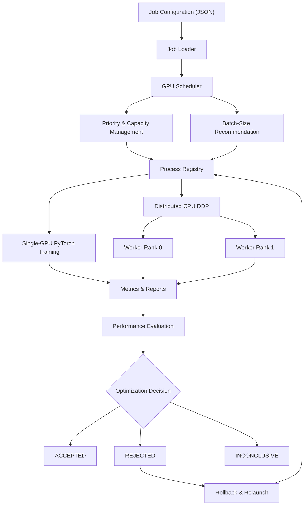
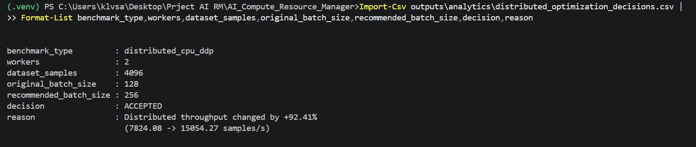

# AI Compute Resource Manager

A local AI compute orchestration project built with Python and PyTorch to explore GPU resource scheduling, workload prioritization, process supervision, distributed training, and performance-aware batch-size optimization.

The system manages training jobs through a priority-based scheduler, monitors resource usage, supports checkpoint-based recovery, and uses measured throughput to evaluate optimization decisions.

**Development environment:** Windows, Python, PyTorch, NVIDIA GeForce RTX 3070 Laptop GPU (8 GB VRAM).

## Key Features

### 1. GPU Resource Scheduling
- Priority-based job admission and queuing.
- Logical GPU memory reservations and protected capacity for high-priority workloads.
- Support for preemptible training jobs.
- Resource reservation reporting and workload lifecycle tracking.

### 2. Preemption and Checkpoint Recovery
- Graceful stop requests for supported training workloads.
- Checkpoint saving and resumption.
- Automatic process launching and lifecycle management.
- Recovery of training jobs following preemption.

### 3. GPU Monitoring
- NVIDIA GPU utilization and VRAM telemetry.
- Per-epoch training loss, duration, and throughput metrics.
- Historical performance data for workload analysis.
- Resource reservation advisories based on observed usage.

### 4. Benchmark-Aware Batch Optimization
- Batch-size benchmarking and throughput comparison.
- Workload-specific configuration recommendations.
- Automatic batch-size selection for supported jobs.
- Historical optimization decisions to avoid repeating rejected configurations.

### 5. Distributed CPU Training
- Multi-process PyTorch DistributedDataParallel (DDP).
- Gloo backend for CPU worker communication.
- Distributed gradient synchronization.
- Worker supervision, process cleanup, and retry handling.
- Distributed checkpointing and recovery.
- Per-epoch throughput measurement.

### 6. Closed-Loop Performance Optimization
- Historical baseline comparison.
- Automatic classification of optimization results:
  - **ACCEPTED:** Measurable performance improvement.
  - **REJECTED:** Throughput regression exceeding the configured tolerance.
  - **INCONCLUSIVE:** Performance change within the tolerance band.
- Automatic rollback of rejected batch-size changes.
- Relaunching jobs with their original configuration.
- Persistent optimization decision history.

## Architecture




## Technology Stack

| Category | Technologies |
|---|---|
| Programming | Python |
| Machine learning | PyTorch |
| GPU acceleration | NVIDIA CUDA |
| GPU monitoring | NVIDIA Management Library (NVML) |
| Distributed training | PyTorch DDP, Gloo |
| Process management | Python subprocess, multiprocessing, psutil |
| Configuration | JSON |
| Analytics | CSV, JSON |
| Development | Windows PowerShell, VS Code |

## Setup

### Prerequisites

- Python compatible with the installed PyTorch version.
- NVIDIA GPU and compatible drivers for CUDA training.
- Windows PowerShell for the documented local workflow.
- Git for version control.

### Installation

Create and activate a virtual environment:

```powershell
python -m venv .venv
.\.venv\Scripts\Activate.ps1
python -m pip install --upgrade pip
```


### Install PyTorch with CUDA Support

This project requires a CUDA-enabled PyTorch installation for GPU training.

Install the appropriate CUDA-enabled PyTorch build using the official instructions:

https://pytorch.org/get-started/locally/

**Important:** PyTorch is intentionally excluded from `requirements.txt` to avoid accidentally replacing a CUDA-enabled installation with a CPU-only build.

After installing PyTorch, install the remaining dependencies:

```powershell
python -m pip install -r requirements.txt
```

Verify that CUDA is available:

```powershell
python -c "import torch; print('PyTorch:', torch.__version__); print('CUDA:', torch.version.cuda); print('CUDA available:', torch.cuda.is_available())"
```

GPU training requires `CUDA available: True`.

Distributed CPU training uses the Gloo backend and does not require CUDA.


## Running the Project

### Single-GPU Training

```powershell
python -m src.train --epochs 3 --steps 100 --batch-size 512
```

### Scheduler and Managed Jobs

```powershell
python -m src.run_jobs --config configs/jobs.json
```

### Distributed CPU Training

```powershell
python -m src.run_jobs --config configs/distributed_jobs.json
```

The distributed configuration uses CPU workers with the Gloo backend. It does not require multiple physical GPUs.

### Standalone Distributed Training

```powershell
python -m src.distributed_launcher --workers 2 --epochs 3 --batch-size 128 --samples 4096
```

### Rollback Integration Test

```powershell
python -m tests.test_distributed_rejection
```

### Inconclusive Decision Test

```powershell
python -m tests.test_distributed_inconclusive
```

## Performance Evaluation

The optimizer compares measured training throughput against a compatible historical baseline.

For distributed workloads, the evaluation uses steady-state throughput from epochs after the first epoch to reduce warm-up effects.

A configurable tolerance determines whether the proposed batch-size change is accepted, rejected, or considered inconclusive.

A rejected configuration triggers rollback and relaunch using the original batch size.

Optimization outcomes are recorded to support future recommendations.

### Example Results

During local testing, one distributed configuration produced:

| Metric | Result |
|---|---|
| Workers | 2 CPU workers |
| Original batch size | 128 per worker |
| Optimized batch size | 256 per worker |
| Baseline steady-state throughput | 7,824.08 samples/s |
| Optimized steady-state throughput | 15,054.27 samples/s |
| Measured improvement | +92.41% |
| Decision | ACCEPTED |


### Recorded Optimization Result



*Recorded local experiment: two CPU workers, batch size increased from 128 to 256, with a measured 92.41% throughput improvement in this run.*


These results were obtained using a synthetic workload on one local machine. They are not representative of production-scale model training and may vary between runs.

## Validation

The following functionality has been exercised during development:

- Single-GPU training and telemetry collection.
- Priority-based scheduling and capacity reservations.
- Training preemption and checkpoint-based recovery.
- Distributed worker startup and synchronization.
- Distributed worker failure and retry scenarios.
- Distributed throughput reporting.
- Automatic batch-size recommendation and application.
- Successful optimization acceptance.
- Simulated throughput-regression rejection and automatic rollback.
- Simulated inconclusive performance evaluation.
- Worker process cleanup.

Some regression and rollback tests use mocked measurements and process objects rather than full distributed training runs.

## Outputs

Generated files are stored under `outputs/`, including:

- GPU monitoring data.
- Training metrics.
- Distributed worker reports.
- Distributed training checkpoints.
- Benchmark results.
- Optimization decision history.

The `outputs/` directory is excluded from Git tracking by `.gitignore`.

## Current Limitations

- Developed and validated primarily on a single Windows machine.
- Distributed training currently uses CPU workers, not multi-node or multi-GPU DDP.
- GPU memory scheduling uses logical reservations rather than hardware-enforced memory isolation.
- Distributed training preemption is not yet supported through the scheduler's normal stop callback.
- Benchmark results can be affected by system load and measurement variability.
- The training workload uses synthetic data rather than a production dataset.

## Future Improvements

- Multi-GPU scheduling and placement.
- Performance-aware capacity allocation using measured GPU utilization.
- Improved benchmarking with repeated trials and statistical confidence.
- Distributed workload preemption.
- Multi-node training support.
- Visualization dashboards for GPU utilization, queue times, and throughput.

## Project Purpose

This project was built to develop practical experience with AI infrastructure concepts, including compute resource management, scheduling, distributed execution, checkpoint recovery, performance benchmarking, and automated optimization.

It is an experimental local orchestration system intended for learning and prototyping, not a production GPU cluster manager.